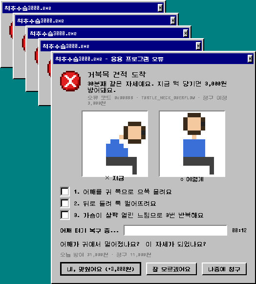
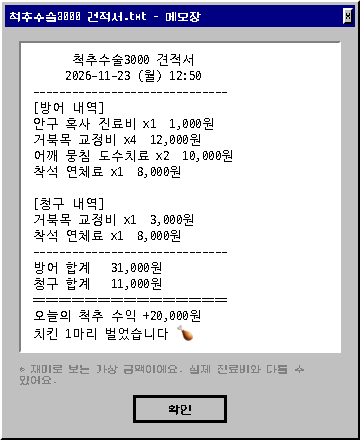

# 척추수술3000 (posture_alert)

> 오늘 당신의 구부정한 목이 청구한 병원비

Windows용 자세 교정 알림 앱. 정해진 간격마다 **Win95 에러창**으로 그림 가이드를 띄워 "이 자세가 되었나요?"라고 묻습니다. 자세를 맞추면 가상 병원비를 **방어**하고, 무시하면 **청구**되며 에러창이 겹겹이 쌓입니다.

| 무시하면 쌓이는 에러창 | 했으면 완료 체크 | 오늘의 견적서 |
|---|---|---|
|  |  |  |

- [PRD.md](PRD.md) — 기획 문서
- [DEV_GUIDE.md](DEV_GUIDE.md) — 개발 가이드 (Python + PySide6 + PyInstaller)
- [docs/IMAGE_PROMPTS.md](docs/IMAGE_PROMPTS.md) — 픽셀 이미지 생성 프롬프트

## 실행 (Mac / Windows 공통)

```bash
uv sync
```
```bash
uv run posture-alert
```

| 명령 | 설명 |
|---|---|
| `POSTURE_DEBUG=1 uv run posture-alert` | 1분이 1초로 줄어든 빠른 모드 (20초마다 눈 알림, 30초마다 자세 체크 …) |
| `uv run posture-alert --demo posture` | 알림 창을 바로 띄우기 (`eye` / `posture` / `stretch` / `stand` / `receipt`), 예시 기록 사용 |
| `uv run posture-alert --demo posture --ghosts 4` | 무시 4번 쌓인 상태 보기 |
| `uv run posture-alert --demo posture --complete` | 완료 체크 화면 보기 |
| `uv run pytest` | 테스트 |

Mac에서는 자리 비움·전체 화면·회의 감지가 가짜 구현(`platform/fake.py`)으로 동작합니다. 실제 감지는 Windows에서만 됩니다.

## Windows exe

`main`에 push하면 GitHub Actions가 Windows에서 exe를 빌드합니다. Actions 탭 → 최신 실행 → **posture-alert-windows** 내려받기 → 압축 풀고 `posture-alert.exe` 실행.

## 구조

```
src/posture_alert/
├── engine/     # 순수 로직: 스케줄러, 문구, 동작 데이터 (Qt·Windows 모름)
├── platform/   # 자리 비움·전체 화면·마이크 감지 (windows.py / fake.py)
├── storage/    # SQLite 기록
├── ui/         # Win95 스타일 창 (retro.py, popup.py)
└── assets/     # exercises.json, img/(픽셀 그림), fonts/(픽셀 폰트)
```

## 기록 (SQLite)

`events` 테이블 하나에 알림 1건 = 1행으로 저장합니다. REST로 치면 **POST → PATCH** 흐름입니다.

| 시점 | 동작 | 값 |
|---|---|---|
| 알림을 띄울 때 | `INSERT` (`create_event`) | `result='shown'`, `completed=0` |
| "네, 맞췄어요" | 같은 행 `UPDATE` (`answer`) | `result='done'`, `completed=1`, `completed_at=시각` |
| 나중에 / 닫기 / 자동 닫힘 | 같은 행 `UPDATE` | `result='snooze' / 'skip' / 'timeout'`, `completed=0` |
| 30분 이상 앉았다가 자리 비움 | `INSERT` (`record`) | `kind='stand'`, `result='away'`, `completed=1` |

예전 DB는 앱을 켤 때 `completed`, `completed_at` 컬럼을 자동으로 추가합니다. DB 위치는 Windows 기준 `%APPDATA%\posture-alert\posture_alert.sqlite3`입니다.

## 폰트

픽셀 폰트 **둥근모꼴+ Fixedsys**(`assets/fonts/DungGeunMo.ttf`, SIL OFL 1.1)를 앱에 포함합니다. 출처와 라이선스는 `assets/fonts/LICENSE-DungGeunMo.txt`를 참고하세요.
