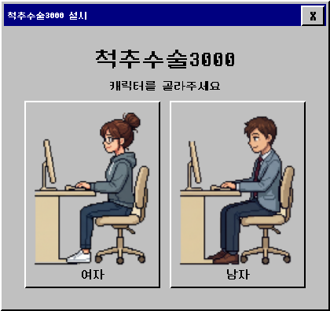
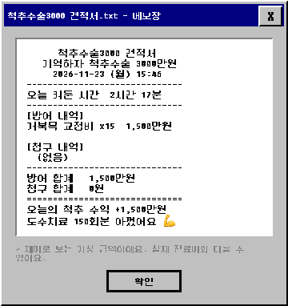
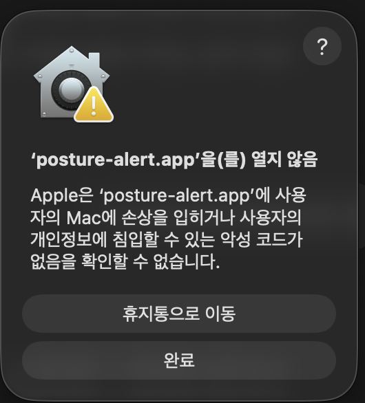
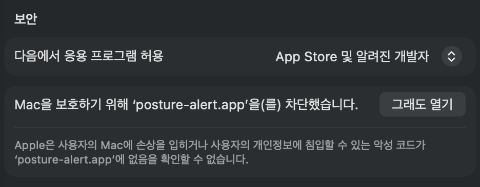

# 척추수술3000

**기억하자, 척추수술 3000만원**

   

일하는 동안 자세를 알려 주는 Windows · Mac 앱입니다. 남은 수술비 **3,000만원 → 0원**을 목표로 합니다.

### [⬇️ Windows 다운로드](https://github.com/JiwonLee42/posture_alert/releases/latest/download/posture-alert-windows.zip) · [⬇️ Mac 다운로드](https://github.com/JiwonLee42/posture_alert/releases/latest/download/posture-alert-macos.zip)

[전체 버전](https://github.com/JiwonLee42/posture_alert/releases) · [사용법](#사용법) · [자주 묻는 질문](#자주-묻는-질문)

| 처음 실행 | 알림 | 했어요 | 오늘의 영수증 |
|---|---|---|---|
|  |  |  |  |

## 이런 앱입니다

- 30분마다 한 가지 동작(눈 → 턱 → 어깨 → 목 → 날개뼈 → 허리 → 발목 → 일어나기)을 알려 줍니다.
- 동작을 따라 하고 **했어요**를 누르면 수술비가 줄고, 무시하면 다시 늘어납니다.
- 알림은 Win95 에러창 모양이고, 화면 구석의 캐릭터는 알림이 오면 거북목이 됩니다.
- 내 컴퓨터 안에서만 동작하며, 서버로 보내는 데이터는 없습니다.

## 최신 업데이트

- **Mac 버전이 추가되었습니다.** 이제 한 Release에 Windows와 Mac 파일이 함께 올라옵니다.
- **로그 파일이 추가되었습니다.** 알림이 언제 왜 떴는지 `posture_alert.log`에 기록됩니다.
- Mac에서도 키보드·마우스 입력 시간으로 자리 비움을 감지합니다.

이전 변경 내용은 [Releases](https://github.com/JiwonLee42/posture_alert/releases)에서 볼 수 있습니다.

## 다운로드

위 **Windows / Mac 다운로드** 버튼을 누르면 최신 zip 파일이 바로 받아집니다.

### Windows

1. `posture-alert-windows.zip`의 압축을 풀고 **`posture-alert.exe`**를 실행합니다.
2. "PC를 보호했습니다"가 뜨면 **추가 정보 → 실행**을 누릅니다. 서명이 없는 앱이라 처음 한 번만 나옵니다.

### Mac (Apple Silicon: M1 이상)

1. `posture-alert-macos.zip`의 압축을 풀면 **`posture-alert.app`**이 나옵니다.
2. 더블클릭하면 아래 경고가 뜹니다. 처음 한 번만 나오며, 악성 코드가 있다는 뜻은 아닙니다. **완료**를 눌러 닫습니다. ("휴지통으로 이동"은 누르지 마세요.)

   

3. **시스템 설정 → 개인정보 보호 및 보안**을 열고, 아래로 내려가 **그래도 열기**를 누릅니다.

   

4. 한 번 더 뜨는 창에서 **열기**를 누릅니다. 이후에는 더블클릭으로 바로 열립니다.

화면 오른쪽 위 메뉴바에 아이콘이 생기며, 메뉴에서 종료할 수 있습니다. Mac은 전체 화면·회의 중 감지를 지원하지 않습니다.

## 사용법

1. 처음 실행하면 **여자 / 남자**를 고르고 **시작**을 누릅니다. 첫 알림이 바로 뜹니다.
2. 이후에는 백그라운드에서 돌면서 30분마다 다음 동작 알림이 뜹니다.
3. 알림을 보고 동작을 따라 한 뒤 **했어요**를 누릅니다. 누를 때까지 알림은 계속 떠 있습니다.
   - **했어요**: 수술비가 줄어듭니다.
   - **나중에 / 닫기**: 수술비가 늘고, 무시한 알림이 뒤에 쌓입니다.
   - 일어나기 알림에서 지금 못 일어나면 **못 일어나요**를 눌러 앉아서 하는 동작으로 바꿀 수 있습니다.

### 캐릭터와 숫자 창

화면 오른쪽 아래의 캐릭터는 평소에 바른 자세로 앉아 있다가, 알림이 뜨면 거북목 자세가 됩니다.

- 캐릭터를 누르면 숫자 창(남은 수술비, 다음 알림까지, 켜둔 시간)이 펼쳐집니다. 다시 누르면 접힙니다.
- 숫자 창의 **X**를 누르면 종료 여부를 묻습니다. **예**를 누르면 오늘의 수술 영수증이 먼저 뜨고, 영수증을 닫으면 종료됩니다.
- 캐릭터는 끌어서 원하는 곳으로 옮길 수 있습니다.

### 트레이 아이콘

| 동작 | 기능 |
|---|---|
| 왼쪽 클릭 | 캐릭터 보이기 / 숨기기 |
| 우클릭 | 오늘 견적서, 다음 단계 바로 하기, 일어나기, 로그 폴더 열기, 종료 |

윈도우에서는 `^` 안에 숨어 있을 수 있습니다.

### 알림 순서와 수술비

알림은 1 → 8단계 순서로 돌고, 90분 연속으로 앉아 있으면 일어나기 알림이 끼어듭니다. 무시하면 +50만원이며, 0원 아래와 3,000만원 위로는 가지 않습니다. 재미로 보는 가상 금액입니다.

| 단계 | 동작 | 했어요 |
|---|---|---|
| 1 | 먼 곳 보기 | -50만원 |
| 2~7 | 턱 당기기 · 어깨 펴기 · 목 옆 늘리기 · 날개뼈 모으기 · 허리 세우기 · 발목 펌프 | -100만원 |
| 8 | 일어나서 물 마시기 | -150만원 |

## 자주 묻는 질문

**창을 닫으면 앱이 꺼지나요?** 아닙니다. 알림 창이나 숫자 창을 닫아도 트레이에서 계속 실행됩니다. 끄려면 트레이 아이콘 우클릭 → **종료**를 누릅니다.

**종료하면 기록이 사라지나요?** 네, 종료하면 기록이 초기화되고 다음 실행은 캐릭터 고르기부터 시작합니다. 기록을 남기려면 `POSTURE_KEEP_DATA=1`을 켜고 실행합니다.

**타이핑 중에도 알림이 뜨나요?** 입력이 잠깐 멈출 때까지 기다렸다가 띄웁니다. 자리를 3분 이상 비우면 일어난 것으로 보고 타이머를 처음부터 다시 셉니다.

**알림이 이상합니다.** 트레이(메뉴바) 아이콘 메뉴의 **로그 폴더 열기**에서 `posture_alert.log`를 확인합니다. 알림이 언제 왜 떴는지 한 줄씩 남아 있습니다. 로그와 기록은 Windows는 `%APPDATA%\posture-alert\`, Mac은 `~/Library/Application Support/posture-alert/`에 있습니다.
