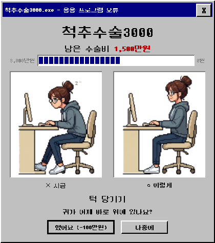
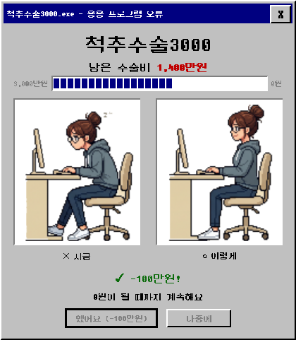
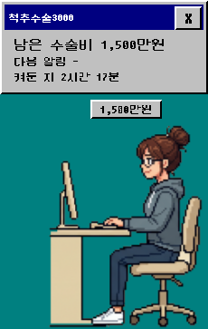

<div align="center">

# 척추수술3000

**기억하자, 척추수술 3000만원**

[](https://github.com/JiwonLee42/posture_alert/releases/latest) [](https://github.com/JiwonLee42/posture_alert/releases)  

일하는 동안 자세를 알려 주는 Windows · Mac 앱 · 남은 수술비 **3,000만원 → 0원**을 목표로!

### [⬇️ Windows 다운로드](https://github.com/JiwonLee42/posture_alert/releases/latest/download/posture-alert-windows.zip) · [⬇️ Mac 다운로드](https://github.com/JiwonLee42/posture_alert/releases/latest/download/posture-alert-macos.zip)

[새로운 점](https://github.com/JiwonLee42/posture_alert/releases/latest) · [전체 버전](https://github.com/JiwonLee42/posture_alert/releases) · [사용법](#사용법) · [자주 묻는 질문](#자주-묻는-질문)

| 처음 실행 | 알림 | 했어요 | 오늘의 영수증 |
|---|---|---|---|
|  |  |  |  |

</div>

## 이런 앱이에요

- ⏰ **30분마다** 한 가지 동작을 알려 줘요. (눈 → 턱 → 어깨 → 목 → 날개뼈 → 허리 → 발목 → 일어나기, 총 8단계)
- 💸 따라 하고 **"했어요"**를 누르면 수술비가 줄고, 무시하면 다시 늘어나요.
- 🖥️ Win95 에러창 모양이라 눈에 확 띄고, 화면 구석의 캐릭터가 **알림이 오면 거북목**이 돼요.
- 🔒 내 PC 안에서만 동작해요. 서버로 보내는 데이터가 없어요.

## 다운로드

위의 **Windows / Mac 다운로드** 버튼을 누르면 최신 버전 zip이 바로 받아져요. (Releases 페이지의 Assets와 같은 파일이에요.)

### Windows

1. `posture-alert-windows.zip`을 풀고 **`posture-alert.exe`**를 더블클릭해요. 설치는 필요 없어요.
2. "PC를 보호했습니다"가 뜨면 **추가 정보 → 실행**을 눌러요. (서명이 없는 앱이라 처음에만 떠요.)

### Mac (Apple Silicon: M1 이상)

1. `posture-alert-macos.zip`을 풀면 **`posture-alert.app`**이 나와요. 응용 프로그램 폴더로 옮기면 편해요.
2. 더블클릭하면 아래처럼 경고가 떠요. **서명이 없는 앱이라 처음 한 번만** 뜨고, 앱이 해롭다는 뜻은 아니에요.
   > Apple은 'posture-alert.app'에 사용자의 Mac에 손상을 입히거나 … 악성 코드가 없음을 확인할 수 없습니다.

   **완료**를 눌러 닫아요. ("휴지통으로 이동"은 누르지 마세요.)
3. **시스템 설정 → 개인정보 보호 및 보안**을 열고, 아래로 스크롤해서 "'posture-alert.app'이(가) 차단되었습니다" 옆의 **그래도 열기**를 눌러요. (비밀번호나 Touch ID를 물어봐요.)
4. 한 번 더 뜨는 창에서 **열기**를 눌러요. 이후에는 더블클릭으로 바로 열려요.

터미널이 편하면 위 2~4 대신 한 줄이면 돼요. (경로는 앱을 둔 곳으로 바꿔요.)
```bash
xattr -dr com.apple.quarantine /Applications/posture-alert.app
```

화면 오른쪽 위 메뉴바에 아이콘이 생겨요. 클릭하면 나오는 메뉴에서 종료할 수 있어요.

> Mac은 키보드·마우스 입력 시간으로 자리 비움을 알아내요. 전체 화면·회의 중 감지는 Windows에서만 돼요.

## 사용법

1. 처음 실행하면 **여자 / 남자**를 고르고 **시작**을 눌러요. 첫 알림이 바로 떠요.
2. 그 뒤로는 **백그라운드**에서 돌면서 **30분마다** 다음 동작 알림이 떠요. 창을 따로 열어 둘 필요 없어요.
3. 알림이 뜨면 그림을 보고 동작을 따라 한 뒤 **했어요**를 눌러요. (누를 때까지 계속 떠 있어요.)
   - **했어요** → 수술비 감소
   - **나중에 / 닫기** → 수술비 증가, 무시한 알림이 뒤에 겹겹이 쌓여요
   - 일어나기 알림에서 지금 못 일어나면 **못 일어나요**로 앉아서 하는 동작으로 바꿀 수 있어요

### 캐릭터와 숫자 창



화면 **오른쪽 아래**에 캐릭터가 떠 있어요. 평소엔 바른 자세로 앉아 있고, **알림이 뜨면 거북목 자세**로 바뀌어요.
- 캐릭터를 **누르면** 숫자 창(남은 수술비 / 다음 알림까지 / 켜둔 시간)이 펼쳐져요. 다시 누르면 접혀요.
- 숫자 창의 **X**를 누르면 "오늘의 척추수술3000을 종료하시겠어요?"가 떠요. **예**를 누르면 **오늘의 수술 영수증**이 먼저 뜨고, 영수증을 닫으면 앱이 종료돼요.
- 캐릭터를 끌어서 원하는 곳으로 옮길 수 있어요.

### 트레이 아이콘

작업표시줄 오른쪽 아래(`^` 안에 숨어 있을 수 있어요)에 아이콘이 남아 있어요.

| 동작 | 설명 |
|---|---|
| 왼쪽 클릭 | 캐릭터 보이기 / 숨기기 |
| 우클릭 | 오늘 견적서 보기 · 다음 단계 바로 하기 · 일어나기 · **종료** |

### 알림 순서

알림마다 1 → 2 → … → 8 → 1 순서로 돌아요. 90분 연속으로 앉아 있으면 순서와 상관없이 "일어나기"가 끼어들어요.

| 단계 | 동작 | 했어요 |
|---|---|---|
| 1 | 먼 곳 보기 | -50만원 |
| 2 | 턱 당기기 | -100만원 |
| 3 | 어깨 펴기 | -100만원 |
| 4 | 목 옆 늘리기 | -100만원 |
| 5 | 날개뼈 모으기 | -100만원 |
| 6 | 의자 위 허리 세우기 | -100만원 |
| 7 | 발목 펌프 | -100만원 |
| 8 | 일어나서 물 마시기 | -150만원 |

무시하면 +50만원이에요. 0원 아래, 3,000만원 위로는 가지 않아요. (재미로 보는 가상 금액이에요.)

## 자주 묻는 질문

**창을 닫으면 앱이 꺼지나요?** 아니요. 알림 창이나 숫자 창을 닫아도 트레이에서 계속 돌아요. 끄려면 트레이 아이콘 우클릭 → **종료**예요.

**앱을 두 번 실행하면요?** 이미 켜져 있으면 두 번째는 조용히 종료돼요.

**종료하면 기록이 사라져요?** 네, 종료하면 기록(수술비, 단계 진행)이 초기화되고 다음 실행은 캐릭터 고르기부터 시작해요. 기록을 남기려면 `POSTURE_KEEP_DATA=1` 환경변수를 켜고 실행하세요.

**타이핑 중에도 알림이 떠요?** 키보드·마우스를 쓰는 중에는 입력이 잠깐 멈출 때까지 기다렸다가 띄워요. 자리를 3분 이상 비우면 "일어난 것"으로 쳐요.

**기록은 어디에 저장돼요?** Windows는 `%APPDATA%\posture-alert\`, Mac은 `~/Library/Application Support/posture-alert/`에 있어요. `posture_alert.sqlite3`(기록)와 `posture_alert.log`(로그)가 들어 있어요.

**알림이 이상해요.** 트레이(메뉴바) 아이콘 메뉴의 **로그 폴더 열기**로 `posture_alert.log`를 열어 보세요. 알림이 언제 왜 떴는지(또는 안 떴는지)가 한 줄씩 남아 있어요.

## 문서

- [개발 문서](docs/DEVELOPMENT.md) — 소스 실행, 빌드·배포, 구조, DB (내부용)
- [버전별 릴리즈 기록](docs/RELEASES.md)
- [PRD](PRD.md) · [개발 가이드](DEV_GUIDE.md) · [이미지 프롬프트](docs/IMAGE_PROMPTS.md)
