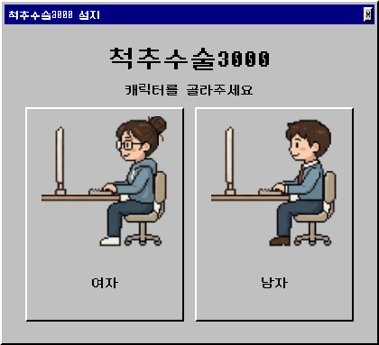
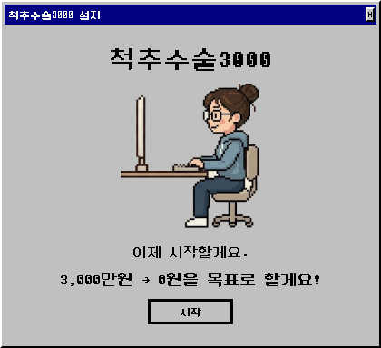
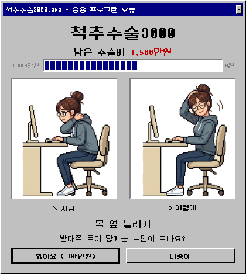
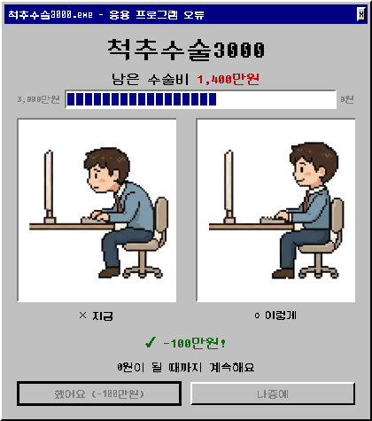

# 척추수술3000

> **기억하자 척추수술 3000만원**

일하는 동안 자세를 알려 주는 Windows 앱이에요. **남은 수술비 3,000만원 → 0원**을 목표로,
알림이 뜰 때마다 동작을 따라 하고 "했어요"를 누르면 수술비가 줄고, 무시하면 다시 늘어나요. 알림은 Win95 에러창 모양이에요.

| 처음 실행 | 시작 | 알림 | 했어요 |
|---|---|---|---|
|  |  |  |  |

## 설치

1. [Releases](../../releases)에서 가장 위(최신) 버전의 **척추수술3000-windows.zip**을 받아요.
2. 압축을 풀고 **`posture-alert.exe`**를 실행해요. 설치는 필요 없어요.
3. 윈도우가 "PC를 보호했습니다" 경고를 띄우면 **추가 정보 → 실행**을 눌러요. (서명이 없는 앱이라 처음에만 떠요.)

## 사용법

1. 처음 실행하면 **여자 / 남자**를 고르고 **시작**을 눌러요. 첫 알림이 바로 떠요.
2. 그 뒤로는 **백그라운드**에서 돌면서 **30분마다** 다음 동작 알림이 떠요. 창을 따로 열어 둘 필요 없어요.
3. 알림이 뜨면 그림을 보고 동작을 따라 한 뒤 **했어요**를 눌러요. (누를 때까지 계속 떠 있어요.)
   - **했어요** → 수술비 감소
   - **나중에 / 닫기** → 수술비 증가, 무시한 알림이 뒤에 겹겹이 쌓여요
   - 일어나기 알림에서 지금 못 일어나면 **못 일어나요**로 앉아서 하는 동작으로 바꿀 수 있어요

### 미니 창


화면 오른쪽 아래에 작게 떠 있어요. **남은 수술비 / 다음 알림까지 / 켜둔 시간**을 보여줘요.
제목줄을 끌어서 옮길 수 있고, ×를 누르면 숨겨져요.

### 트레이 아이콘

작업표시줄 오른쪽 아래(`^` 안에 숨어 있을 수 있어요)에 아이콘이 남아 있어요.

| 동작 | 설명 |
|---|---|
| 왼쪽 클릭 | 미니 창 열기 / 숨기기 |
| 우클릭 | 오늘 견적서 보기 · 다음 단계 바로 하기 · 일어나기 · **종료** |

### 알림 순서

알림마다 1 → 2 → … → 8 → 1 순서로 돌아요. 90분 연속으로 앉아 있으면 순서와 상관없이 "일어나기"가 끼어들어요.

| 단계 | 동작 | 했어요 |
|---|---|---|
| 1 | 먼 곳 보기 | -50만원 |
| 2 | 턱 당기기 | -100만원 |
| 3 | 어깨 펴기 | -100만원 |
| 4 | 목 옆 늘리기 | -100만원 |
| 5 | 날개뼈 모으기 | -100만원 |
| 6 | 의자 위 허리 세우기 | -100만원 |
| 7 | 발목 펌프 | -100만원 |
| 8 | 일어나서 물 마시기 | -150만원 |

무시하면 +50만원이에요. 0원 아래, 3,000만원 위로는 가지 않아요. (재미로 보는 가상 금액이에요.)

## 자주 묻는 질문

**창을 닫으면 앱이 꺼지나요?** 아니요. 알림 창이나 미니 창을 닫아도 트레이에서 계속 돌아요. 끄려면 트레이 아이콘 우클릭 → **종료**예요.

**앱을 두 번 실행하면요?** 이미 켜져 있으면 두 번째는 조용히 종료돼요.

**종료하면 기록이 사라져요?** 네, 종료하면 기록(수술비, 단계 진행)이 초기화되고 다음 실행은 캐릭터 고르기부터 시작해요. 기록을 남기려면 `POSTURE_KEEP_DATA=1` 환경변수를 켜고 실행하세요.

**타이핑 중에도 알림이 떠요?** 키보드·마우스를 쓰는 중에는 입력이 잠깐 멈출 때까지 기다렸다가 띄워요. 자리를 3분 이상 비우면 "일어난 것"으로 쳐요.

**기록은 어디에 저장돼요?** `%APPDATA%\posture-alert\posture_alert.sqlite3` (SQLite)예요.

## 개발자용

- [PRD.md](PRD.md) — 기획 문서
- [DEV_GUIDE.md](DEV_GUIDE.md) — 개발 가이드 (Python + PySide6 + PyInstaller)
- [docs/IMAGE_PROMPTS.md](docs/IMAGE_PROMPTS.md) — 픽셀 이미지 생성 프롬프트

### 소스에서 실행 (Mac / Windows 공통)

```bash
uv sync
```
```bash
uv run posture-alert
```

| 명령 | 설명 |
|---|---|
| `POSTURE_EVERY_SECONDS=3 uv run posture-alert` | 테스트: 3초마다 다음 단계 알림 (마우스를 움직여도 바로 뜸) |
| `POSTURE_DEBUG=1 uv run posture-alert` | 1분이 1초로 줄어든 빠른 모드 (20초마다 눈 알림, 30초마다 자세 체크 …) |
| `uv run posture-alert --demo posture` | 알림 창을 바로 띄우기 (`eye` / `posture` / `stretch` / `stand` / `receipt` / `onboarding` / 단계 번호 `1`~`8`), 메모리 DB 사용 |
| `uv run posture-alert --demo posture --ghosts 4` | 무시 4번 쌓인 상태 보기 |
| `uv run posture-alert --demo posture --complete` | 했어요 누른 화면 보기 |
| `POSTURE_KEEP_DATA=1 uv run posture-alert` | 종료해도 기록을 지우지 않음 (기본은 종료 시 초기화) |
| `uv run pytest` | 테스트 |

Mac에서는 자리 비움·전체 화면·회의 감지가 가짜 구현(`platform/fake.py`)으로 동작합니다. 실제 감지는 Windows에서만 됩니다.

### 빌드와 배포

`main`에 push하면 GitHub Actions(`build-windows`)가 테스트 → exe 빌드 → **Release**(`v1.0.<실행번호>`)까지 자동으로 만듭니다.
Release 본문 맨 위에는 [RELEASE_NOTES.md](RELEASE_NOTES.md)가 들어가니, **push 전에 이번 개선사항으로 고쳐 두세요.**
Release 없이 빌드 결과만 받으려면 Actions 탭 → 실행 → Artifacts의 `posture-alert-windows`.

### 구조

```
src/posture_alert/
├── engine/     # 순수 로직: 스케줄러, 문구, 동작 데이터 (Qt·Windows 모름)
├── platform/   # 자리 비움·전체 화면·마이크 감지 (windows.py / fake.py)
├── storage/    # SQLite 기록
├── ui/         # Win95 스타일 창 (retro.py, popup.py)
└── assets/     # exercises.json, img/(픽셀 그림), fonts/(픽셀 폰트)
```

### 남은 수술비

| 알림 | 했어요 | 무시 (닫기·나중에·자동 닫힘) |
|---|---|---|
| 눈 휴식 | -50만원 | +50만원 |
| 자세 체크 · 스트레칭 | -100만원 | +50만원 |
| 일어나기 | -150만원 | +50만원 |

0원 아래, 3,000만원 위로는 가지 않습니다. 시작한 시각(`settings.started_at`) 이후 `events` 기록으로 계산합니다.

### 종료하면 초기화

트레이 메뉴 "종료"로 끄면 `Repo.reset()`이 `events`, `cycles`, `sessions`, `settings` 행을 모두 지웁니다 (`stages` 단계 정의는 유지, 번호도 1부터).
다음 실행은 캐릭터 고르기부터 다시 시작합니다. 기록을 남기려면 `POSTURE_KEEP_DATA=1`로 실행하세요.

### 기록 (SQLite)

`events` 테이블 하나에 알림 1건 = 1행으로 저장합니다. REST로 치면 **POST → PATCH** 흐름입니다.

| 시점 | 동작 | 값 |
|---|---|---|
| 알림을 띄울 때 | `INSERT` (`create_event`) | `result='shown'`, `completed=0` |
| "네, 맞췄어요" | 같은 행 `UPDATE` (`answer`) | `result='done'`, `completed=1`, `completed_at=시각` |
| 나중에 / 닫기 / 자동 닫힘 | 같은 행 `UPDATE` | `result='snooze' / 'skip' / 'timeout'`, `completed=0` |
| 30분 이상 앉았다가 자리 비움 | `INSERT` (`record`) | `kind='stand'`, `result='away'`, `completed=1` |

예전 DB는 앱을 켤 때 `completed`, `completed_at` 컬럼을 자동으로 추가합니다. DB 위치는 Windows 기준 `%APPDATA%\posture-alert\posture_alert.sqlite3`입니다.

### 단계 사이클

알림이 뜰 때마다 단계 **1 → 2 → … → 8 → 1** 순서로 돕니다 (기본 30분마다 한 단계, `POSTURE_EVERY=분`으로 조절).
연속으로 90분 앉아 있으면 순서와 상관없이 8단계(일어나기)가 끼어듭니다. 이때 사이클 위치는 그대로예요.

| 단계 | enum | 자세 |
|---|---|---|
| 1 | `EYE_FAR` | 먼 곳 보기 |
| 2 | `CHIN_TUCK` | 턱 당기기 |
| 3 | `SHOULDER_OPEN` | 어깨 펴기 |
| 4 | `NECK_SIDE` | 목 옆 늘리기 |
| 5 | `SCAPULA_SQUEEZE` | 날개뼈 모으기 |
| 6 | `SEAT_BACK` | 의자 위 허리 세우기 |
| 7 | `ANKLE_PUMP` | 발목 펌프 |
| 8 | `STAND_WATER` | 일어나서 물 마시기 |

단계 정의(자세·멘트)는 코드의 `engine/stages.py`가 기준이고, 앱을 켤 때 `stages` 테이블로 복사됩니다.

### 테이블

| 테이블 | 한 행 | 주요 컬럼 |
|---|---|---|
| `stages` | 단계 1개 | `id`(enum 값), `code`, `exercise_id`(자세), `title`·`body`(멘트) |
| `cycles` | 사이클 1바퀴 | `position`(마지막으로 보여준 단계), **`stage_1` ~ `stage_8`** (했으면 1, 0/1만 허용) |
| `events` | 알림 1건 | `stage`, `cycle_id`, `result`, `completed`, `completed_at` |
| `sessions` | 앱 실행 1번 | `started_at`, `last_seen_at`, **`uptime_minutes`** (켠 뒤로 지난 분) |

- "네, 맞췄어요" → `events` 행 PATCH + `cycles.stage_N = 1` PATCH
- 앱을 다시 켜면 마지막 `cycles.position` 다음 단계부터 이어서 돕니다.
- 켜둔 시간은 메모리 카운터(`engine/uptime.py`)가 들고 있다가, **분이 바뀔 때만** `sessions` 행을 UPDATE합니다.

### 폰트

픽셀 폰트 **둥근모꼴+ Fixedsys**(`assets/fonts/DungGeunMo.ttf`, SIL OFL 1.1)를 앱에 포함합니다. 출처와 라이선스는 `assets/fonts/LICENSE-DungGeunMo.txt`를 참고하세요.
